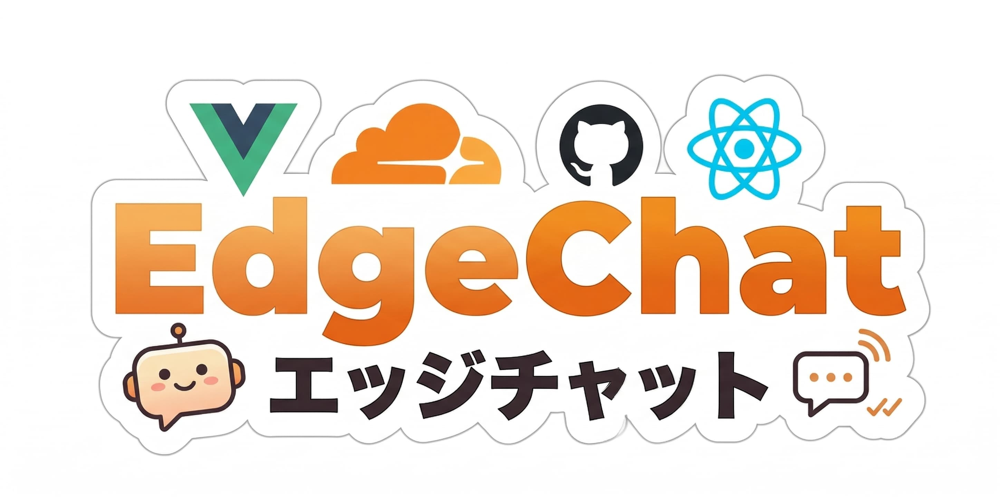
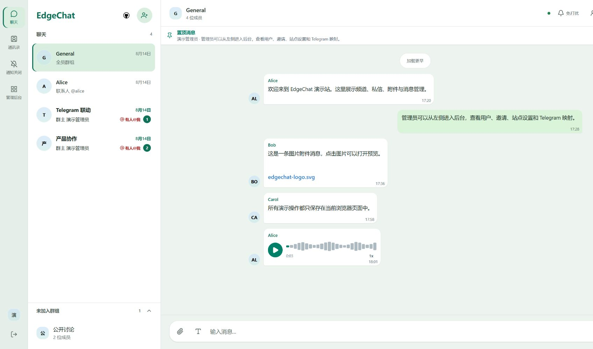
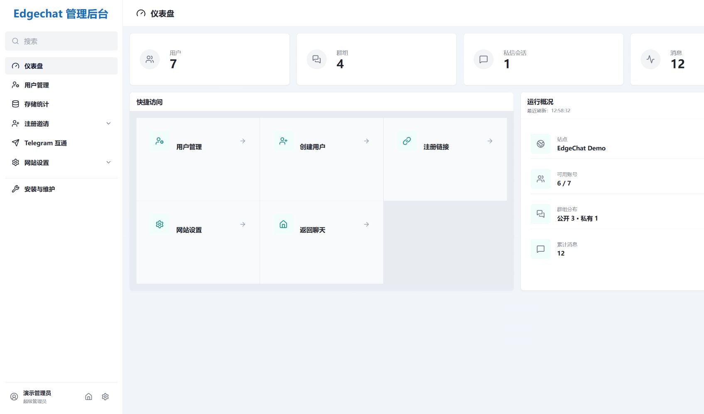

<div align="center">
  

  <h3>自分のチャットスペースを、サーバーの保守から始める必要はありません。</h3>
  <p>Cloudflare を基盤としたオープンソースのセルフホスト型チームチャットシステム</p>
  <p>リアルタイムのグループチャットとダイレクトメッセージ · Telegram 双方向ブリッジ · 音声とファイル · メッセージと添付ファイルのサーバーサイド暗号化</p>

  <p>
    
    
    
    
    
  </p>

  <p>
    <a href="README.md">中文</a> ·
    <a href="README.en.md">English</a> ·
    <a href="README.ja.md"><b>日本語</b></a> ·
    <a href="https://edgechat-demo.wcjxxgaq.workers.dev">オンラインデモ</a> ·
    <a href="https://echat.azora.top/">プロジェクトドキュメント</a> ·
    <a href="https://t.me/EdgeChatlounge">Telegram コミュニティ</a>
  </p>
</div>

<br />

**EdgeChat は Cloudflare 上で動作するオープンソースのチームチャットシステムです。** チーム、プロジェクト、または小さなコミュニティのために独立したチャットスペースを構築できます。議論はグループに、個人的な話はダイレクトメッセージに、音声やファイルも手軽に共有できます。

常時稼働するサーバーを別途保守する必要はありません。アプリケーションとデータリソースは自分の Cloudflare アカウントにデプロイされ、GitHub Actions によって自動的にデプロイ・更新されます。メンバーがすでに Telegram を使っている場合は、両方のグループを接続し、それぞれ慣れたチャット入口を使い続けることもできます。

[インターフェースプレビュー](#インターフェースプレビュー) · [オンラインデモ](#オンラインデモ) · [Telegram ブリッジ](#telegram-双方向ブリッジ) · [機能](#機能) · [プライバシーと暗号化](#プライバシーと暗号化) · [デプロイ](#デプロイ) · [ローカル開発](#ローカル開発)

## ダイレクトメッセージの音声通話

`2.11.0` から Web の DM で一対一音声通話を利用できます。既定は P2P、接続失敗時は TURN に切り替わり、電話横の小さな選択欄で手動切替も可能です。応答、拒否、ミュート、終了、通話時間を表示します。グループ、ビデオ、オフライン着信は対象外で、デモは実際の通話を行いません。

TURN には Worker / Repository Secrets の `EDGECHAT_TURN_KEY_ID` と `EDGECHAT_TURN_API_TOKEN` が必要です。未設定では P2P のみ利用できます。Cloudflare の SFU と TURN は月間最初の 1,000 GB の無料枠を共有し、超過分は $0.05/GB です。[設定とプロトコル](docs/api/voice-calls.md) を参照してください。

## インターフェースプレビュー

<table>
  <tr>
    <td width="50%" align="center"><strong>チャット画面</strong></td>
    <td width="50%" align="center"><strong>管理画面</strong></td>
  </tr>
  <tr>
    <td width="50%"></td>
    <td width="50%"></td>
  </tr>
</table>

## オンラインデモ

**[EdgeChat オンラインデモを開く →](https://edgechat-demo.wcjxxgaq.workers.dev)**

まず画面を確認してから、デプロイするか決めてください。

デモサイトは正式プロジェクトの Vue ページ、ルーティング、状態管理、リアルタイムメッセージ処理を再利用しています。ただし API、WebSocket、ファイルアップロード、Telegram からの転送はすべてブラウザー内のメモリ上でシミュレートされており、実際のバックエンドに接続するマルチユーザーチャットではありません。

ページを更新するか、右上の「デモデータをリセット」をクリックすると初期状態に戻ります。デモでの操作が正式 Worker にアクセスしたり、D1、KV、R2 に書き込んだりすることはありません。

## EdgeChat を選ぶ理由

EdgeChat は、**自分のチャットスペースを持ちたいが、そのためにサーバー、データベース、一式の実行環境を長期的に保守したくない**というニーズに応えます。

| 気になること | EdgeChat の方法 |
|---|---|
| デプロイと保守 | Cloudflare Workers を基盤とし、常時稼働サーバーの別途保守は不要。GitHub Actions による自動デプロイに対応 |
| メンバーと管理 | 独立したアカウント、公開・非公開グループ、ダイレクトメッセージ、管理画面を提供 |
| 既存の Telegram グループ | Bot による双方向ブリッジで、両側のメンバーが慣れた入口を使い続けられる |
| 自分で変更・拡張 | ソースコードを公開しており、ニーズに合わせて画面や機能を調整可能 |

プロジェクト自体は無料のオープンソースです。クラウドサービスの料金は Cloudflare のプラン、リソース構成、実際の使用量によって異なります。

## Telegram 双方向ブリッジ

**全員を同じアプリに移行させる必要はありません。**

管理者は管理画面で EdgeChat の公開・非公開グループを確認し、任意のグループを Telegram グループに紐付けられます。Telegram Bot を介してメッセージが双方向に転送され、Web 上で送信したメッセージは Telegram に同期され、Telegram グループのメッセージも EdgeChat に戻ってきます。一対一のダイレクトメッセージはブリッジされません。

Telegram グループがすでにあり、同時に独立した Web チャット入口も必要とするチームやコミュニティに適しています。

<div align="center">
  
  <br />
  <sub>2 つのチャット入口、1 つの議論。</sub>
</div>

## 機能

### 💬 チャットと会話

- 公開グループ、非公開グループ、一対一のダイレクトメッセージ。
- リアルタイムメッセージ、履歴のページング、音声メッセージ、ファイル共有。
- メッセージへの返信、引用ジャンプ、@ メンションと返信通知。
- ダイレクトメッセージの連絡先のブロックと解除。ブロック中は双方ともダイレクトメッセージを送信できません。
- 期限切れメッセージの定期的な完全削除に対応。

### 🎨 日常の使いやすさ

- Liquid Glass スタイルのインターフェース。デスクトップとモバイルに対応。
- 音声録音、波形による進捗表示、再生速度変更。
- Web フロントエンドでサイト内メッセージ通知を提供。バックグラウンドではブラウザーのシステム通知を利用できますが、ユーザーの許可が必要です。
- ファイルアップロード、アバター管理、基本的なアクセシビリティ対応。

### 🛠 インスタンス管理

- ダッシュボード、ユーザー管理、登録招待、サイト設定。
- 永久 BAN と、日・時間・分単位の一時 BAN に対応。一時 BAN は期限切れ後に自動復旧し、追加の定期タスクは不要です。
- ブラウザー上でソースコードリポジトリと直接比較し、現在のデプロイに更新があるか確認。

### 🔌 接続と拡張

- 管理者が設定する公開・非公開グループと Telegram の双方向メッセージブリッジ。音声メッセージの同期にも対応。
- WebMCP サイトツール：対応クライアント環境で、ログイン、会話の検索、メッセージの読み取り・送信などを提供。

## プライバシーと暗号化

EdgeChat は**新たに書き込まれるメッセージ本文と新たにアップロードされる添付ファイル**に AES-256-GCM のサーバーサイド保存時暗号化を使用します。履歴の平文データはそのまま保持され、読み取り時には新旧データの両方に対応します。デプロイやバックグラウンドタスクで一括暗号化することはありません。

管理画面にはグループやダイレクトメッセージの本文を閲覧する入口はありませんが、メッセージ数などの集計統計は確認できます。

> [!NOTE]
> **これはサーバーサイド暗号化であり、エンドツーエンド暗号化ではありません。**
> Worker はセッション権限を検証した後に内容を復号します。Cloudflare の実行環境と鍵を管理するデプロイ担当者は、引き続き信頼する必要があります。管理画面にメッセージ閲覧入口がないことは、デプロイ担当者が技術的に内容へアクセスできないことを意味しません。
>
> Telegram ブリッジを有効にすると、転送されたメッセージも対応する Telegram 会話に入ります。

<details>
<summary><strong>鍵の管理とローテーションについて</strong></summary>

<br />

GitHub Actions はサーバーサイド暗号化の Worker Secrets を管理します。初回デプロイ時に対象 Worker に暗号化 Secret が存在しない場合、ワークフローはランダムな 32 バイト AES 鍵を自動生成し、独立したバージョン付き Secret として注入し、現在の active key ID を記録します。その後の通常デプロイではこれらの Secret の存在だけを確認し、再生成、上書き、ローテーションは行いません。

本番環境にすでに存在する `EDGECHAT_ENCRYPTION_KEYRING` JSON 鍵リングはそのまま保持され、引き続き互換性があります。

鍵を手動で指定する場合は、`EDGECHAT_ENCRYPTION_KEYRING` という名前の GitHub Repository Secret を作成できます。

```json
{"activeKeyId":"v1","keys":{"v1":"BASE64_ENCODED_32_BYTE_KEY"}}
```

初回デプロイではこの値がそのまま採用されます。

既存 Worker で自動的に増分ローテーションするには、`Deploy Worker` を手動実行し、`rotate_encryption_key` にチェックを入れます。ワークフローはバージョン付きの鍵 Secret を 1 つだけ追加し、active key ID を新しいバージョンへ切り替えます。すべての旧 Secret と旧 JSON 鍵リングは変更されません。新しいメッセージには新しい鍵を使用し、旧暗号文は各エンベロープの key ID に対応する鍵で復号します。

`apply_encryption_keyring` は手動で上書きするための予備の入口です。使用時は Repository Secret に完全な JSON 鍵リングを指定し、`keys` に履歴の暗号文から引き続き参照されるすべての旧 key ID を残したうえで、新しい鍵を追加し `activeKeyId` を更新する必要があります。

**旧 key を削除すると、対応する履歴の暗号文を永久に読み取れなくなります。** `apply_encryption_keyring` と `rotate_encryption_key` は同じ実行で同時に有効化できません。

</details>

## 技術スタック

| 部分 | 技術 |
|---|---|
| フロントエンド | Vue 3、Vue Router、Vite |
| バックエンド | Cloudflare Workers、Hono |
| リアルタイム通信 | Durable Objects、WebSocket Hibernation |
| データベース | Cloudflare D1 |
| セッションストレージ | Cloudflare KV |
| ファイルストレージ | Cloudflare R2 |
| ビルドとデプロイ | Wrangler、GitHub Actions |

実装の詳細は [TECHNICAL.md](TECHNICAL.md) を参照してください。

## デプロイ

**初回ログイン：管理者の既定パスワードと公開登録はありません。schema SQL はアカウントを作成しません。** Actions では `EDGECHAT_ADMIN_USERNAME` / `EDGECHAT_ADMIN_PASSWORD` を Repository Secrets に設定し、手動デプロイでは管理者初期化 SQL を生成して実行してください。[初回管理者設定](docs/admin-bootstrap.md#english)にコマンドと設定漏れの対応を記載しています。ログイン後、管理者がユーザーや登録招待を作成します。

### GitHub Actions による自動デプロイ

デプロイとその後の更新には、リポジトリに組み込まれた GitHub Actions ワークフローの利用を推奨します。`Sync Upstream` は毎日 2 回確認し、コミット末尾の `EdgeChat-Update: stable` / `security` が付いた上流リリースをマージして明示的にデプロイを起動します。初回設定とトークン権限は[更新ガイド](https://echat.azora.top/en/guide/updating-fork)、`MESSAGE_RETENTION_DAYS` は[デプロイガイド](https://echat.azora.top/en/guide/actions-deploy)を参照してください。

ドキュメントに従って Cloudflare の認証とリポジトリ設定を完了すると、`Deploy Worker` を手動実行できます。また、`master` または `main` ブランチにコードをプッシュしてデプロイをトリガーすることもできます。ワークフローファイルは `.github/workflows/deploy-worker.yml` です。

**[クイックスタート](https://echat.azora.top/guide/getting-started.html) · [GitHub Actions デプロイチュートリアル](https://echat.azora.top/guide/actions-deploy.html)**

### 手動デプロイと Docker

ローカル手動デプロイのリソース準備、設定方法、注意事項は [デプロイドキュメント](https://echat.azora.top/guide/getting-started.html) を参照してください。

Docker の説明は [DOCKER.md](DOCKER.md) を参照してください。

### Android クライアント

<details>
<summary>クライアント、インストール、ビルドの説明を見る</summary>

<br />

`capacitor/` クライアントは APK に Vue Web UI を内蔵し、少量の Kotlin コードでシステムのファイル選択、通知、マイク権限、通知からの会話移動、外部リンクに接続します。パッケージ名は `com.aozorae.edgechat.web` で、初回ログイン時に自分の EdgeChat HTTPS サービスアドレスを入力します。特定のデプロイには紐付きません。

- インストールパッケージ：[GitHub Releases](https://github.com/aozorae/Edgechat/releases) から `edgechat-*.apk` をダウンロードし、`SHA256SUMS.txt` を確認。
- 初回利用：自分の EdgeChat HTTPS サービスアドレス、アカウント、パスワードを入力。
- ローカルビルド：JDK 21 と Android SDK 36 を準備し、`npm run build:capacitor` を実行。
- Debug APK：`capacitor/android/app/build/outputs/apk/debug/app-debug.apk`。
- CI：`.github/workflows/capacitor-android-ci.yml` が `edgechat-capacitor-debug` をアップロード。
- リリース：`android-v*` タグをプッシュするか `Android Release` を手動実行し、4 つの `ANDROID_KEYSTORE_*` Secrets で署名済み APK/AAB をビルド。
- サービス切り替え：ログアウト後にアドレスを変更できます。インスタンス切り替え時には旧インスタンスのトークンを自動消去します。

現在、Room オフラインデータベース、WorkManager Outbox、FCM は含まれていません。アプリが停止してメッセージを受信できない場合、バックグラウンドでの即時通知は保証されません。

ネイティブ `android/` Kotlin + Jetpack Compose クライアントは一時的に廃止され、既定のリリース版ではありません。ソース、API v1 契約、独立した CI は一時的に保持しています。

詳細は [Android クライアントドキュメント](https://echat.azora.top/guide/android.html) を参照してください。

</details>

## ローカル開発

```bash
# ソースコードを取得
git clone https://github.com/aozorae/Edgechat.git
cd Edgechat

# 依存関係をインストール
npm install

# クラウドリソースを先にデプロイせず、フロントエンドのみのデモを起動
npm run dev:demo
```

実際のバックエンドに接続して開発またはデプロイする前に、ドキュメントに従って対応する Cloudflare リソースと設定を準備してください。

```bash
# フロントエンド開発
npm run dev:frontend

# ローカルビルド
npm run build

# ローカル手動リリース
npm run deploy
```

<details>
<summary>デモサイトのビルド、デプロイ、CI 環境変数</summary>

<br />

```bash
# デモサイトを独立してビルド
npm run build:demo

# 独立したデモ Worker をデプロイ
npm run deploy:demo
```

デモサイトは `wrangler.demo.toml` と `.github/workflows/deploy-demo.yml` を使用し、Worker 名は `edgechat-demo` です。GitHub Actions は手動トリガーのみをサポートし、`DEMO_CLOUDFLARE_ACCOUNT_ID`、`DEMO_CLOUDFLARE_API_TOKEN` を読み取ります。既存の本番デプロイワークフローは変更しません。

非対話環境でデプロイする場合は、あらかじめ `CLOUDFLARE_API_TOKEN` を設定してください。

管理画面の更新チェックは、ビルド時に現在の GitHub リポジトリ、ブランチ、コミットを自動記録します。正確な結果を得るには、手動デプロイを、すでにプッシュされたクリーンなコミットに基づく Git リポジトリ内で実行してください。ソースコードリポジトリは公開状態である必要があり、ブラウザーが GitHub Compare API を直接呼び出せます。この処理で定期タスクが作成されることはありません。

PowerShell の例：

```powershell
$env:CLOUDFLARE_API_TOKEN = "your-token"
npm run deploy
```

</details>

## プロジェクト構成

<details>
<summary>主要ディレクトリを見る</summary>

```text
Edgechat/
├─ assets/previews/       # インターフェースプレビュー
├─ frontend/              # Vue フロントエンドとブラウザー内デモ
├─ worker/
│  ├─ schema.sql         # データベーススキーマ
│  ├─ migrations/        # データベースマイグレーション
│  └─ src/               # API、認証、Durable Objects
├─ capacitor/            # Web UI ベースの Android クライアント
├─ android/              # 一時的に保持されるネイティブ Android クライアント
├─ .github/workflows/    # 自動デプロイと CI
├─ wrangler.toml
├─ wrangler.demo.toml
├─ package.json
├─ README.md
├─ README.en.md
├─ README.ja.md
└─ LICENSE
```

</details>

## 交流と貢献

問題がある場合、機能について議論したい場合、または独自の使い方を共有したい場合は、[Issue](https://github.com/aozorae/Edgechat/issues) を提出してください。[Telegram コミュニティ](https://t.me/EdgeChatlounge) への参加も歓迎します。

コード、ドキュメント、翻訳、フィードバックはすべてプロジェクトの改善に役立ちます。Pull Request を歓迎します。

EdgeChat を支援してくださったすべての貢献者に感謝します：

[](https://github.com/aozorae/Edgechat/graphs/contributors)

PWA 対応の [PR #31](https://github.com/aozorae/Edgechat/pull/31) を提出してくださった [@fix221](https://github.com/fix221) に感謝します。

## Star History

<a href="https://www.star-history.com/?type=date&repos=aozorae%2FEdgechat">
 <picture>
   <source media="(prefers-color-scheme: dark)" srcset="https://api.star-history.com/chart?repos=aozorae/Edgechat&type=date&theme=dark&legend=top-left&sealed_token=GpyqTbdwb3a2OHOT-WlCSoSzrumr3iwtcNluTpGbcU5CuyfP4eKf9TjtDuJ2uY4XK0P6knEB6OFCkbaAMsMCO3vnGPprGvB4f4rd7kmbUNe3fJ8LNaaGVH7JZLDT7SNNy3DC-sBxZwBmfL7gP9AFv1iKX1FgYnRZuOBGcKkbWFlBuoq2TXpYIfWmoUF9" />
   <source media="(prefers-color-scheme: light)" srcset="https://api.star-history.com/chart?repos=aozorae/Edgechat&type=date&legend=top-left&sealed_token=GpyqTbdwb3a2OHOT-WlCSoSzrumr3iwtcNluTpGbcU5CuyfP4eKf9TjtDuJ2uY4XK0P6knEB6OFCkbaAMsMCO3vnGPprGvB4f4rd7kmbUNe3fJ8LNaaGVH7JZLDT7SNNy3DC-sBxZwBmfL7gP9AFv1iKX1FgYnRZuOBGcKkbWFlBuoq2TXpYIfWmoUF9" />
   
 </picture>
</a>

## ライセンス

本プロジェクトは **GNU GPL v3.0 or later** を採用しています。詳細は [LICENSE](LICENSE) を参照してください。

## 謝辞

プロジェクトの普及にご協力くださった [linux do](https://linux.do) に感謝します。

## 免責事項

EdgeChat はセルフホスト型のオープンソースプロジェクトです。プロジェクトメンテナーはソフトウェア自体のみを提供し、ユーザーが自分でデプロイしたインスタンスの運用、管理、制御は行いません。

インスタンスのデプロイ担当者と利用者は、デプロイ方法、利用行為、そこで生成されるコンテンツとデータについて自ら責任を負うものとします。

プロジェクトメンテナーは、個別にデプロイされたインスタンスの利用または悪用について責任を負いません。
